 

**Hi, I'm Sparsh.** I'm a BTech Computer Science student who can't leave a black box closed: if something works, I want to know *why*, and then I want to try building my own version. Right now that curiosity is split between security tooling, local AI, networking, and electronics.

 

## `01` · about

I'm not a one-language, one-stack person, and I don't want to be. The thing I enjoy most is the moment a system stops being magic: reading a manifest to see what an app is really asking for, flashing a router to see how far the radio can be pushed, or wiring logic gates until the truth table finally agrees with the breadboard.

My interests cut across layers on purpose. Software, operating systems, networks, silicon and the interface a human actually touches all feed into each other, and I learn faster when I can follow a problem down through them.

## `02` · technology universe

Solid outline = visible in my public repos. Dashed = things I tinker with, but haven't published yet.

## `03` · featured projects

<table>
  <tr>
    <td width="50%" valign="top">
      <h3><a href="https://github.com/jainnsparsh/Permission-Sentinel-Web">Permission-Sentinel-Web</a></h3>
      
A context-aware Android permission auditor built for <b>CyberCup Hackathon 6.0</b>. It reads an APK or manifest, compares what the app <i>says</i> it does against what it <i>asks for</i>, and produces a transparent 0–100 risk score.

      <ul>
        <li>Deterministic, explainable rule engine instead of an opaque model</li>
        <li>Local-first: FastAPI + SQLite backend, nothing leaves your machine</li>
        <li>React / TypeScript dashboard, plus synthetic benchmark apps to test the scoring</li>
      </ul>
      
<code>Python</code> <code>FastAPI</code> <code>SQLite</code> <code>TypeScript</code> <code>React</code> <code>Vite</code> <code>Tailwind CSS</code> <code>Androguard</code> <code>pytest</code>

    </td>
    <td width="50%" valign="top">
      <h3><a href="https://github.com/jainnsparsh/Permission-Sentinel-Android">Permission-Sentinel-Android</a></h3>
      
The cross-platform side of the same idea: a native Android app, a FastAPI backend and a React dashboard working together to flag excessive app permissions with explainable risk scores.

      <ul>
        <li>Fork of <a href="https://github.com/Rohankhulbe61/Permission-Sentinel-Android">Rohankhulbe61/Permission-Sentinel-Android</a></li>
        <li>Android app + backend + dashboard in one repo</li>
        <li>Ships with sample fixtures and one-click run scripts</li>
      </ul>
      
<code>Python</code> <code>Android</code> <code>FastAPI</code> <code>React</code>

    </td>
  </tr>
</table>

<!--
  More projects:
  Add new repos here as they go public (e.g. the AICTE-CaseSync team project), using the same
  <td> block. Quality over quantity: two or three cards is plenty.
-->

## `04` · technology stack

<table>
  <tr>
    <th align="left" width="34%">In use visible in my repos</th>
    <th align="left" width="33%">Exploring hands-on, not published yet</th>
    <th align="left" width="33%">Want to go deeper</th>
  </tr>
  <tr>
    <td valign="top">
      <code>Python</code> <code>TypeScript</code> <code>FastAPI</code> <code>React</code> <code>Vite</code> <code>Tailwind CSS</code> <code>SQLite</code> <code>Androguard</code> <code>pytest</code> <code>Git</code> <code>GitHub</code>
    </td>
    <td valign="top">
      <code>Local LLMs</code> <code>OpenWrt</code> <code>Linux</code> <code>Arduino</code> <code>Digital logic</code>
    </td>
    <td valign="top">
      <code>Operating systems</code> <code>Computer architecture</code> <code>Embedded systems</code> <code>Open source</code> <code>UI/UX &amp; graphic design</code>
    </td>
  </tr>
</table>

## `05` · current exploration

 

- **Running models locally.** What actually limits a model on consumer hardware: memory, bandwidth, quantisation, and where the trade-offs sit.
- **OpenWrt and wireless.** Router firmware, Wi-Fi behaviour and squeezing real performance out of cheap hardware.
- **Electronics from the ground up.** Arduino, digital logic and how a computer is really put together.
- **Collaborative software.** Building with a team, which is a different skill from building alone.

## `06` · github analytics

  
  

  

  

## `07` · connect

  
  
  <!-- Uncomment and fill in when ready:
  
  
  -->

  <code>~/lab $ ./keep-tinkering.sh</code>

