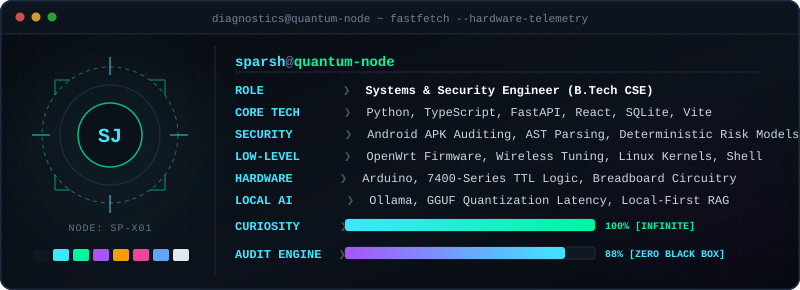

<div align="center">

<!-- ANIMATED CAPSULE HEADER -->


<!-- HERO TERMINAL BANNER -->


<br>

<!-- ANIMATED TYPING EFFECT -->
<a href="https://github.com/jainnsparsh">
  
</a>

<br>

<!-- LIVE BADGES ROW -->
<p>
  
  &nbsp;
  
  &nbsp;
  
  &nbsp;
  
</p>

<!-- QUICK NAV -->
<p>
  <code><a href="#-about-me">ABOUT</a></code> · 
  <code><a href="#-tech-universe">UNIVERSE</a></code> · 
  <code><a href="#-flagship-projects">PROJECTS</a></code> · 
  <code><a href="#-arsenal">ARSENAL</a></code> · 
  <code><a href="#-telemetry">TELEMETRY</a></code> · 
  <code><a href="#-analytics">ANALYTICS</a></code> · 
  <code><a href="#-connect">CONNECT</a></code>
</p>

</div>

<!-- STATUS HUD -->


<br>


<h2> <a id="-about-me"></a>About Me</h2>

```js
const sparsh = {
    role:       "B.Tech CSE Student & Systems Engineer",
    philosophy: "If it's a black box, I take it apart",
    interests:  ["Security Tooling", "Local AI", "Open Source", "IoT"],
    layers:     ["UI/UX", "Backend", "OS/Kernel", "Network", "Silicon"],
    currently:  "Building Permission Sentinel • Exploring OpenWrt & TTL Logic",
    fun_fact:   "I debug circuits on breadboards and code on terminals — same brain"
};
```

I am deeply invested in **open-source contributions, backend systems, IoT, wireless networking, and cybersecurity**. My interests deliberately span the entire computing stack — from **React dashboards** down to **7400-series logic gates**. Following a problem to bare metal makes me write cleaner, more resilient high-level code.

<br>


<h2> <a id="-tech-universe"></a>Tech Universe</h2>



<div align="center">
  <sub><b>Solid borders</b> → Shipped in repos &nbsp;•&nbsp; <b>Dashed borders</b> → Lab exploration &amp; hardware benches</sub>
</div>

<br>


<h2> <a id="-flagship-projects"></a>Flagship Projects</h2>

<p align="center">
  <a href="https://github.com/jainnsparsh/Permission-Sentinel-Web">
    
  </a>
  &nbsp;
  <a href="https://github.com/jainnsparsh/Permission-Sentinel-Android">
    
  </a>
</p>

<table>
  <tr>
    <td width="50%" valign="top">
      <h3>🛡️ Permission-Sentinel-Web</h3>
      <p>
        
        
        
      </p>
      <p>Context-aware Android APK permission auditor. Compares what an app <i>declares</i> vs what it <i>demands</i> — producing a transparent, explainable 0–100 risk score. <b>Zero opaque ML. Zero cloud dependency.</b></p>
      <p><code>Python</code> <code>FastAPI</code> <code>SQLite</code> <code>TypeScript</code> <code>React</code> <code>Vite</code> <code>Tailwind</code> <code>Androguard</code> <code>pytest</code></p>
    </td>
    <td width="50%" valign="top">
      <h3>📱 Permission-Sentinel-Android</h3>
      <p>
        
        
      </p>
      <p>Native companion app — scans installed packages on-device, audits runtime permissions, syncs with the FastAPI backend, and surfaces privilege escalations through the React dashboard.</p>
      <p><code>Android SDK</code> <code>Java</code> <code>Python</code> <code>FastAPI</code> <code>React</code> <code>Security Analysis</code></p>
    </td>
  </tr>
</table>

<details>
  <summary><b>🔬 In-Flight Lab Experiments</b></summary>
  <br>
  
  | Initiative | Architecture | Status |
  |:---|:---|:---|
  | **AICTE-CaseSync** | Team governance & case-flow tracking platform | `In Development` |
  | **Edge LLM Quant Studio** | 4-bit vs 8-bit GGUF benchmarking on consumer RAM | `Benchmarking` |
  | **7400-Series Discrete ALU** | Breadboard ALU from raw NAND/NOR/XOR gates | `Hardware Lab` |
</details>

<br>


<h2> <a id="-arsenal"></a>Technical Arsenal</h2>

<!-- SKILL ICONS — single visual hit -->
<p align="center">
  <a href="https://skillicons.dev">
    
  </a>
</p>

<table>
  <tr>
    <td width="18%"><b>Languages</b></td>
    <td>
      
      
      
      
      
      
    </td>
  </tr>
  <tr>
    <td><b>Web / Backend</b></td>
    <td>
      
      
      
      
      
      
    </td>
  </tr>
  <tr>
    <td><b>Security</b></td>
    <td>
      
      
      
      
    </td>
  </tr>
  <tr>
    <td><b>Systems / HW</b></td>
    <td>
      
      
      
      
      
    </td>
  </tr>
  <tr>
    <td><b>Local AI</b></td>
    <td>
      
      
      
      
    </td>
  </tr>
</table>

<br>


<h2> <a id="-telemetry"></a>Lab Telemetry</h2>



<br>

### Active Workbench
- ⚡ **Local LLM Performance:** Benchmarking memory bandwidth saturation and tok/s latency curves across quantization depths.
- 📡 **OpenWrt Firmware:** Tuning radio propagation, packet queues, and stripped micro-package builds on consumer routers.
- 🔌 **TTL Logic Synthesis:** Constructing synchronous counters and arithmetic units from discrete 7400-series gates.
- 🛡️ **Permission Sentinel v2:** Expanding the heuristic matrix to catch modern Android background execution vectors.
- 🤝 **Open-Source Collaboration:** Building with teams — clean git conventions, test-driven repos, code review culture.

<br>


<h2> <a id="-analytics"></a>Engineering Analytics</h2>

<!-- CONTRIBUTION STREAK -->
<p align="center">
  
</p>

<!-- STATS + LANGUAGES -->
<p align="center">
  
  
</p>

<!-- PROFILE SUMMARY CARDS -->
<p align="center">
  
</p>

<p align="center">
  
  
  
</p>

<br>


<h2> <a id="-connect"></a>Connect</h2>

<p align="center">
  <i>Security problems, firmware hacking, open-source collaboration — my signal is always on.</i>
</p>

<p align="center">
  <a href="https://github.com/jainnsparsh">
    
  </a>
  &nbsp;
  <a href="https://www.linkedin.com/in/sparsh-jain-0a7b35383/">
    
  </a>
  &nbsp;
  <a href="mailto:sparshdarsh78@outlook.com">
    
  </a>
</p>

<br>


<div align="center">

```bash
sparsh@quantum-core:~/lab$ ./keep-tinkering.sh --depth=silicon --black-boxes=0
[+] Scanning all layers... SOFTWARE ✓ NETWORK ✓ OS ✓ FIRMWARE ✓ SILICON ✓
[+] Black boxes found: 0
[+] Status: ALWAYS_CURIOUS
[+] exit code: 0 [CONTINUOUS_EXPLORATION]
```

<sub>No black boxes were harmed in the making of this profile. ⚡</sub>

<!-- ANIMATED FOOTER WAVE -->


</div>
